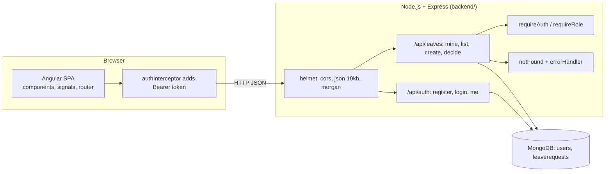
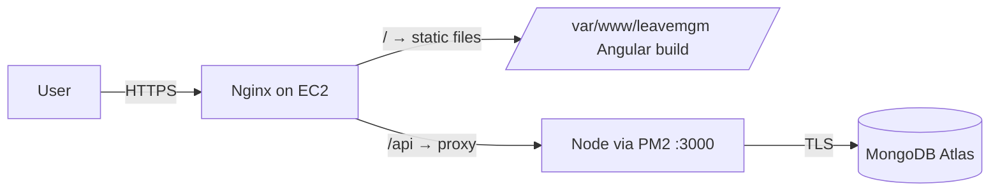
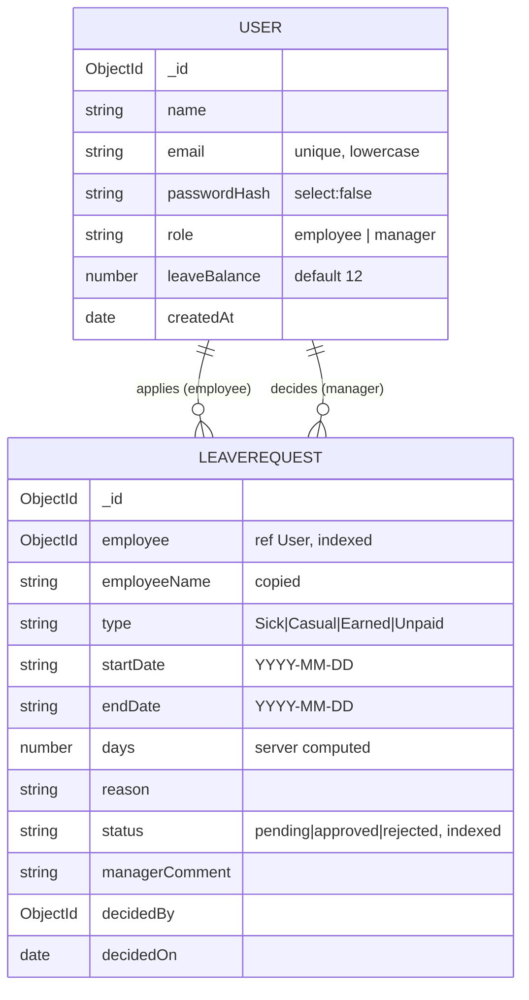
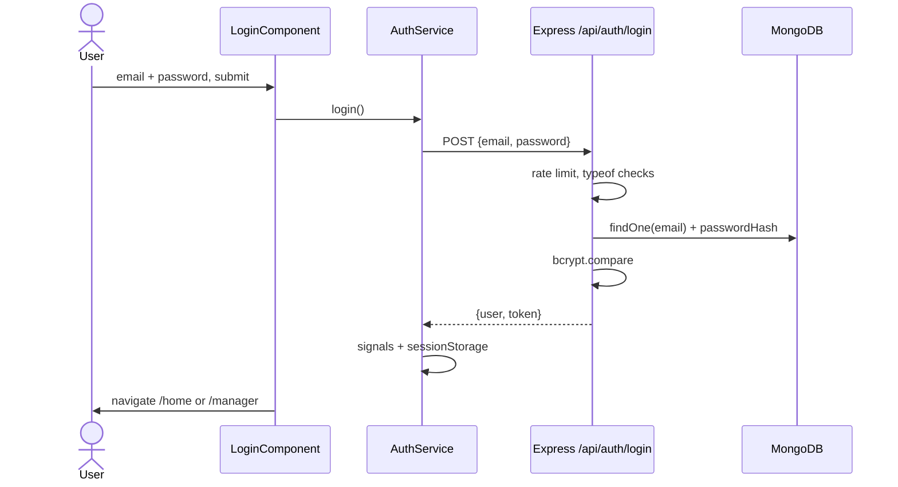
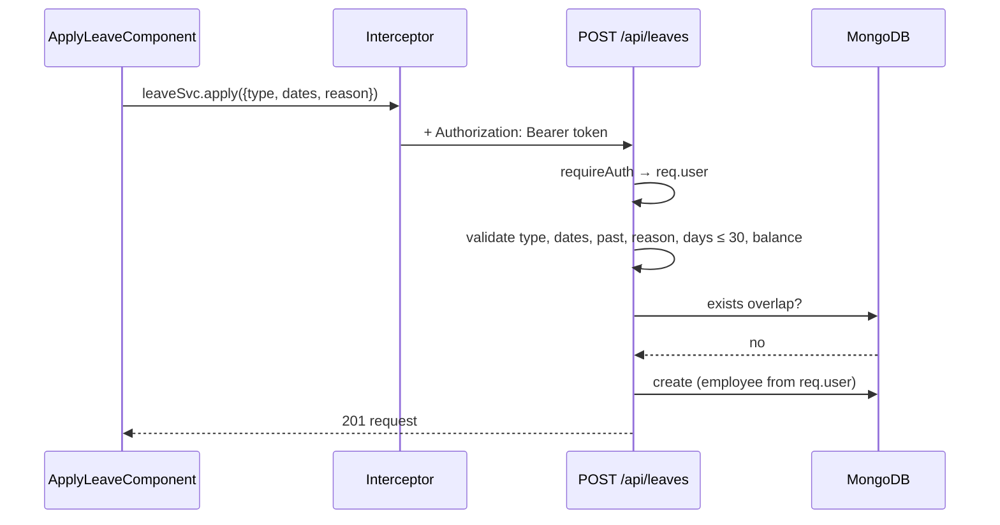
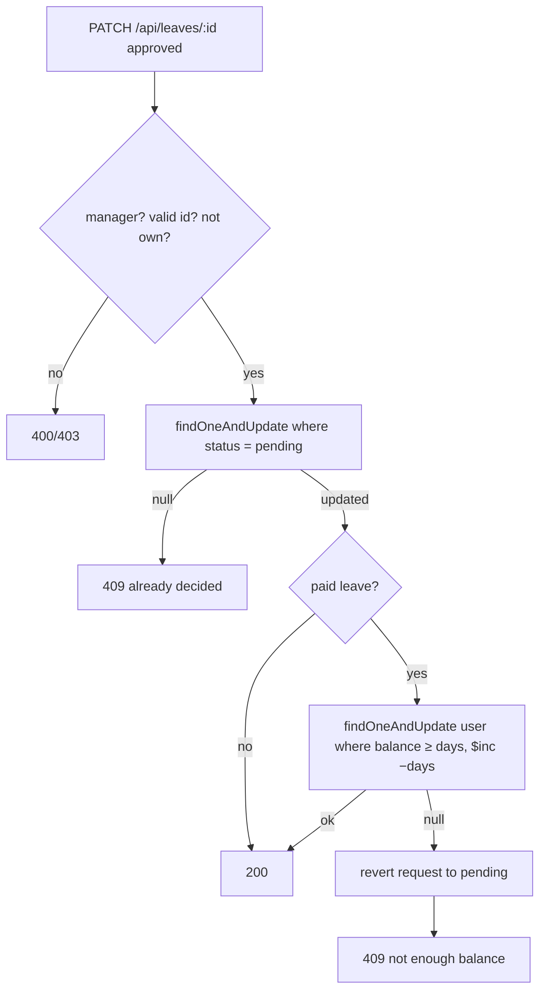

# Leaflet (leavemgm): the complete guide

For someone who knows **HTML, CSS, JavaScript and Python**. This project adds **TypeScript, Angular, Node.js, Express,
MongoDB, Mongoose, JWT, bcrypt, REST APIs, testing and AWS deployment**. Each is explained from zero, compared to things
you already know, and connected to the exact files in this repo.

---

## Table of contents

1. [The project in one minute](#1-the-project-in-one-minute)
2. [The tech stack, explained from zero](#2-the-tech-stack-explained-from-zero)
3. [Architecture](#3-architecture)
4. [Database design](#4-database-design)
5. [The API](#5-the-api)
6. [Backend file-by-file](#6-backend-file-by-file)
7. [Frontend file-by-file](#7-frontend-file-by-file)
8. [Main flows with diagrams](#8-main-flows-with-diagrams)
9. [Security, explained](#9-security-explained)
10. [Testing](#10-testing)
11. [Deployment](#11-deployment)
12. [Decisions and why](#12-decisions-and-why)
13. [Honest weaknesses and fixes](#13-honest-weaknesses-and-fixes)
14. [Build it yourself from scratch](#14-build-it-yourself-from-scratch)
15. [Change requests you might get](#15-change-requests-you-might-get)
16. [Interview and recruiter questions](#16-interview-and-recruiter-questions)
17. [Glossary](#17-glossary)
18. [Self-check exercises](#18-self-check-exercises)

---

## 1. The project in one minute

**What it does:** Employees sign up, apply for leave (Casual, Sick, Earned, Unpaid) and see their history and balance.
Managers see pending requests and approve or reject them with a note. Approving paid leave reduces the employee's balance.

**Elevator pitch:**

> "Leaflet is a full-stack leave management system: an Angular 17 single-page app talking to a Node/Express REST API with
> MongoDB. Authentication uses JWT and bcrypt, roles are enforced on the server, and all business rules, like overlap
> checks, balance limits and preventing double approval, are validated server-side with atomic updates. It has automated
> API tests and a documented AWS deployment with Nginx and PM2."

---

## 2. The tech stack, explained from zero

### 2.1 Node.js

You know JavaScript in the browser. **Node.js** runs JavaScript **outside** the browser, on a server, like `python script.py`.
`node src/server.js` starts the backend. `npm` is Node's package manager (like pip); `package.json` is like `requirements.txt` plus scripts.

`require('express')` is Node's older import style (CommonJS), like Python's `import`. `module.exports = ...` is what a file exports.

### 2.2 Express

A small web framework for Node. Same job as Flask:

| Flask | Express |
|-------|---------|
| `app = Flask(__name__)` | `const app = express()` |
| `@app.get("/health")` | `app.get('/api/health', (req, res) => res.json({...}))` |
| `request.json` | `req.body` (after `app.use(express.json())`) |
| `return jsonify(x), 201` | `res.status(201).json(x)` |
| Blueprint | `express.Router()` |
| `@app.before_request` | middleware: `app.use(fn)` |

**Middleware** is the key Express idea: a function `(req, res, next)` that runs in order for each request. It can stop the request
(send a response) or call `next()` to pass it on. Error middleware has four arguments `(err, req, res, next)`.

### 2.3 REST APIs and JSON

A **REST API** exposes data as URLs (resources) and uses HTTP methods as verbs:

| Method | Meaning | Here |
|--------|---------|------|
| GET | read | `GET /api/leaves/mine` |
| POST | create | `POST /api/leaves` |
| PATCH | partly update | `PATCH /api/leaves/:id` |
| DELETE | remove | (not used yet) |

Status codes you will see: 200 OK, 201 Created, 400 Bad Request, 401 not logged in, 403 not allowed, 404 Not Found, 409 Conflict, 500 server error.

### 2.4 MongoDB

A **NoSQL document database**. Instead of tables and rows (MySQL), it stores **collections** of **documents** that look like JSON:

```json
{ "_id": "66f...", "name": "Asha", "email": "asha@x.com", "role": "employee", "leaveBalance": 12 }
```

No fixed schema at the database level, and each document gets a unique `_id` (an **ObjectId**). Queries are objects too:
`{ status: 'pending' }` means `WHERE status = 'pending'`; `{ startDate: { $lte: '2026-10-30' } }` means `startDate <= '2026-10-30'`.

**MongoDB Atlas** is MongoDB hosted in the cloud, with a free tier.

### 2.5 Mongoose

An **ODM** (Object Document Mapper) for MongoDB, like an ORM for SQL. It adds what MongoDB lacks: a **schema** with types,
required fields, enums, min/max, defaults and indexes. `User.findOne({...})`, `LeaveRequest.create({...})` return Promises.

### 2.6 TypeScript

JavaScript with **types**. It compiles to plain JavaScript.

```ts
let days: number = 3;
interface User { id: string; name: string; role: 'employee' | 'manager'; leaveBalance: number; }
function greet(u: User): string { return 'Hi ' + u.name; }
```

The compiler catches mistakes like passing a string where a number is expected, before the code runs. Angular is written in TypeScript.

### 2.7 Angular 17

A **framework** for building single-page apps (SPA). A **SPA** loads one HTML page, then JavaScript swaps views without full reloads.

Core ideas in this repo:

- **Component:** a TypeScript class + HTML template + CSS file = one piece of UI. `@Component({ selector, templateUrl, styleUrl, standalone: true, imports })`.
- **Template syntax:** `{{ value }}` prints, `(click)="submit()"` handles events, `[disabled]="!canSubmit()"` binds a property,
  `[(ngModel)]` two-way binds a form input, `@if (...) { }` and `@for (x of list; track x.id) { }` are control flow.
- **Signals:** `signal(0)` is a reactive value. Read with `count()`, write with `count.set(1)`. When it changes, the UI updates.
  `computed(() => ...)` is a value derived from other signals that recalculates automatically (like a spreadsheet formula).
- **Services:** classes that hold shared logic (HTTP calls, current user). `@Injectable({ providedIn: 'root' })` = one shared instance.
- **Dependency injection:** `inject(AuthService)` gets the shared service.
- **Router:** maps URLs to components. `loadComponent: () => import(...)` is **lazy loading**: the code for a page downloads only when visited.
- **Guards:** functions that decide if a route can open (`authGuard`, `managerGuard`).
- **HttpClient + interceptor:** `HttpClient` makes requests and returns **Observables** (from RxJS). The **interceptor** runs on every request: it adds the JWT header and logs you out on 401.
- **RxJS Observables:** like Promises that can emit many values. Here they are used like Promises: `.subscribe({ next, error })`. `pipe(tap(...))` runs a side effect.

### 2.8 JWT (JSON Web Token)

A signed token that proves who you are. It has three base64 parts: header, payload (`{ sub: userId, role, exp }`), signature.
The server signs it with `JWT_SECRET`. Anyone can **read** the payload, but nobody can **change** it without the secret, because the
signature would not match. The client sends it on every request: `Authorization: Bearer <token>`.

**Stateless:** the server does not store sessions; it just verifies the signature.

### 2.9 bcrypt

A **password hashing** function. You never store passwords; you store `bcrypt.hash(password, 10)`. On login, `bcrypt.compare` checks.
bcrypt is deliberately **slow** (cost factor 10 = 2^10 rounds) and adds a random **salt**, so stolen hashes are very hard to crack.
`bcryptjs` is a pure-JavaScript version (no native build tools needed). The 72-character password limit exists because bcrypt ignores bytes after 72.

### 2.10 Security middleware

- **helmet:** sets safe HTTP headers (content security policy, no sniffing, frame protection).
- **cors:** browsers block a page on one origin from reading responses from another origin unless the server allows it. The allow-list here is `CORS_ORIGINS`.
- **express-rate-limit:** max 30 login/register attempts per 15 minutes per IP, to slow password guessing.
- **morgan:** logs each request.

### 2.11 Nginx, PM2, EC2

- **EC2:** a rented Linux computer on AWS.
- **Nginx:** a fast web server. It serves the built Angular files and **reverse-proxies** `/api` to Node on port 3000.
- **PM2:** keeps the Node process running, restarts it if it crashes and on reboot.

---

## 3. Architecture



**Production:**



Because Nginx serves both from one origin, the production app calls `/api` (relative) and CORS is not even needed.

---

## 4. Database design



Design notes:

- **`passwordHash` has `select: false`**, so it is never loaded unless you ask with `.select('+passwordHash')`. A forgotten field can never leak.
- **`toJSON` transforms** decide exactly what the API returns (`id` instead of `_id`, no hash). They match the TypeScript interfaces in `leave.model.ts`.
- **`employeeName` is copied** into each request (denormalisation) so the manager list does not need a join. Trade-off: if a user renames, old requests keep the old name.
- **Dates as `YYYY-MM-DD` strings.** These sort and compare correctly as plain strings, which makes the overlap query simple, and they avoid time zone shifts.
- **Indexes** on `employee` and `status` make "my requests" and "pending requests" fast.
- **`decidedBy`, `decidedOn`** form an audit trail.

---

## 5. The API

| Method | Path | Who | Body → Result |
|--------|------|-----|---------------|
| GET | `/api/health` | public | `{status:"ok"}` |
| POST | `/api/auth/register` | public | `{name,email,password}` → `{user,token}` (always employee) |
| POST | `/api/auth/login` | public | `{email,password}` → `{user,token}` |
| GET | `/api/auth/me` | signed in | fresh user |
| GET | `/api/leaves/mine` | signed in | own requests |
| GET | `/api/leaves?status=` | manager | all requests |
| POST | `/api/leaves` | signed in | `{type,startDate,endDate,reason}` → request |
| PATCH | `/api/leaves/:id` | manager | `{status, managerComment?}` → request |

Try it with curl:

```bash
TOKEN=$(curl -s -X POST localhost:3000/api/auth/login -H 'Content-Type: application/json' \
  -d '{"email":"employee@leaflet.dev","password":"Leaflet@123"}' | node -pe 'JSON.parse(require("fs").readFileSync(0)).token')
curl -s localhost:3000/api/leaves/mine -H "Authorization: Bearer $TOKEN"
```

---

## 6. Backend file-by-file

### `backend/src/config.js`

Reads environment variables (via `dotenv` from `.env`). **Fails fast**: throws on startup if `JWT_SECRET` or `MONGODB_URI` is missing, or if the
production secret is shorter than 32 characters. Better to crash at start than run insecurely.

### `backend/src/app.js`

Builds the Express app, but does **not** start listening. Why separate from `server.js`? Tests can import `app` and send fake requests with
supertest without opening a port or connecting a real database.

Order: `trust proxy` (production, so rate limiting sees the real IP behind Nginx) → `helmet` → `cors` → `express.json({limit:'10kb'})` →
`morgan` → health route → routers → `notFound` → `errorHandler`.

### `backend/src/server.js`

Connects to MongoDB, then listens. **Graceful shutdown:** on `SIGTERM` (sent by PM2 or the OS) it stops accepting new requests, finishes current ones, disconnects Mongo, exits.

### `backend/src/middleware/auth.js`

- `signToken(user)`: JWT with `sub` (subject = user id) and `role`, expires in 8 h.
- `requireAuth`: reads `Bearer` token, verifies it, **loads the user from the DB** (so a deleted user or changed balance is current), sets `req.user`.
- `requireRole(...roles)`: a function that **returns** middleware (a "factory"). `requireRole('manager')` blocks non-managers with 403.

### `backend/src/middleware/errors.js`

Turns known errors into clean messages: `CastError` (bad id) → 400, `ValidationError` → 400, duplicate key `11000` → 409, bad JSON → 400, anything else → 500 (with detail only in development, so internals never leak in production).

### `backend/src/models/User.js`, `LeaveRequest.js`

Schemas as described in section 4. They also export the allowed `ROLES`, `LEAVE_TYPES`, `LEAVE_STATUSES` so routes reuse one list.

### `backend/src/routes/auth.js`

- **Register:** validates name (2-80), email (regex), password (8-72), checks duplicates (409), hashes, creates with `role: 'employee'` **always** (no one can make themselves a manager), returns user + token.
- **Login:** rejects non-string inputs (blocks `{"$ne": ""}` injection), finds by lowercase email, `bcrypt.compare`. Same message for wrong email or wrong password, so attackers cannot learn which emails exist.
- **Me:** returns `req.user`.

### `backend/src/routes/leaves.js` (the heart)

`router.use(requireAuth)` protects every route in the file.

`parseIsoDate` checks format **and** that it is a real date: `2026-02-30` becomes March 2 in JavaScript, so it compares the round-trip string to reject it.

**Create (POST) rules, in order:**

1. Type must be one of the four.
2. Both dates valid; end not before start.
3. Only Sick leave can start in the past.
4. Reason 5-500 characters.
5. `days = (end - start) / 1 day + 1` (inclusive). Max 30.
6. Paid leave cannot exceed balance.
7. **Overlap check:** two ranges overlap when `existing.start <= new.end AND existing.end >= new.start`. Only pending or approved requests count.
8. Create with `employee` and `employeeName` from `req.user`, never from the body.

**Decide (PATCH) rules:**

1. Valid ObjectId, status is approved/rejected, comment ≤ 500.
2. Request exists; manager is not the owner (no self-approval).
3. **Atomic claim:** `findOneAndUpdate({ _id: id, status: 'pending' }, {...})`. The condition and the update happen in one database operation.
   If two managers click at the same moment, only one matches `status: 'pending'`; the other gets `null` → 409. This prevents a **race condition**.
4. If approved paid leave: `findOneAndUpdate({ _id: employee, leaveBalance: { $gte: days } }, { $inc: { leaveBalance: -days } })`.
   Again atomic: balance can never go negative. If it fails, the request is **rolled back** to pending (a manual compensation, since there is no multi-document transaction).

### `backend/src/seed.js`

Wipes and creates demo users (one manager, two employees) and sample requests.

### `backend/ecosystem.config.js`

PM2 config: script path, environment, restart policy.

---

## 7. Frontend file-by-file

### Bootstrapping

`src/main.ts` starts the app with `bootstrapApplication(AppComponent, appConfig)`. `app.config.ts` provides the router and `HttpClient` with the interceptor.
`app.component.ts` is the root with a `<router-outlet>` where pages appear.

### `app.routes.ts`

`'' → login`. `home`, `apply`, `history` need `authGuard`. `manager` needs `authGuard` and `managerGuard`. `**` (anything else) → login.
Every page is lazy-loaded.

### `core/models/leave.model.ts`

TypeScript interfaces `User`, `LeaveRequest`, `LeaveType`, `LeaveStatus`. They mirror the backend `toJSON` shapes, which is the **contract** between front and back.

### `core/services/auth.service.ts`

Holds `token` and `currentUser` as **signals**, restored from `sessionStorage` on load. `login`, `register` call the API and `startSession` saves both.
`refresh()` re-reads `/me` (to update the balance after approval). `logout()` clears everything. `isLoggedIn()`.

### `core/services/leave.service.ts`

`mine()`, `all(status?)`, `apply(data)`, `decide(id, status, comment)`. Thin wrappers around `HttpClient`.

### `core/guards/auth.guard.ts`

`authGuard` → if not logged in, go to `/login`. `managerGuard` → if not manager, go to `/home`. **These are only for user experience.** The real protection is on the server.

### `core/interceptors/auth.interceptor.ts`

For requests to our API: clone the request and add `Authorization: Bearer ...`. If the server answers **401** (expired), log out and go to login.
Requests are immutable in Angular, which is why it uses `req.clone`.

### `core/utils/http-error.ts`

Turns any HTTP error into a friendly string (server `message`, or "cannot reach server" for status 0).

### Features

| Component | What it does |
|-----------|--------------|
| `login` | Form, demo-fill buttons in dev, redirect by role |
| `register` | Sign-up form |
| `home` | Balance, pending count, recent activity; calls `auth.refresh()` |
| `apply-leave` | Signals for each field; `days` and `canSubmit` are `computed`; shows server errors |
| `history` | All own requests with a status filter |
| `manager` | Pending queue, approve/reject with optional note |
| `shared/navbar` | Links by role, sign-out |

### Styles

`src/styles.css` defines **design tokens** (CSS custom properties) and shared classes. Each component's CSS is **scoped** to that component by Angular.

### Environments

`environment.ts` → `apiUrl: 'http://localhost:3000/api'`. `environment.prod.ts` → `apiUrl: '/api'`. The build swaps them.

---

## 8. Main flows with diagrams

### Login



### Apply for leave



### Manager approves (race-safe)



---

## 9. Security, explained

| Risk | What could happen | Defence here |
|------|-------------------|--------------|
| Password theft | DB leak exposes passwords | bcrypt hashes, `select:false` |
| Brute force | Guess passwords | Rate limit 30 / 15 min |
| NoSQL injection | `{"email":{"$ne":""}}` logs in as anyone | `typeof === 'string'` checks |
| Privilege escalation | Register as manager | Role forced to `employee` |
| Broken access control | Employee calls manager API | `requireRole('manager')` on server |
| Tampering | Client sends `days: 1` for a 10-day leave | Server computes `days`, `employee` |
| Race condition | Two approvals deduct twice | Atomic conditional updates |
| Large body DoS | 100 MB JSON | `limit: '10kb'` |
| Info leak | Stack traces to users | Detail only in development |
| Token theft via XSS | Script reads sessionStorage | Angular escapes templates; httpOnly cookie would be stricter |
| Weak secret | Forge JWTs | Production requires 32+ char secret |

---

## 10. Testing

- **Runner:** Node's built-in `node --test` (no Jest needed).
- **supertest:** sends HTTP requests directly to the `app` object.
- **mongodb-memory-server:** starts a temporary MongoDB in memory, so tests never touch real data.
- `smoke.test.js`: things that need no DB (routes exist, 401 without token, validation, CORS headers, helmet headers).
- `api.test.js`: register, login, roles, overlap, balance, double decision.

```bash
cd backend && npm test
```

---

## 11. Deployment

Full steps are in `docs/AWS_DEPLOYMENT.md`. Summary:

1. MongoDB Atlas free cluster; allow the EC2 IP; get the connection string.
2. EC2 Ubuntu instance; install Node, Nginx, PM2.
3. Clone repo; `backend/.env` with production values; `pm2 start ecosystem.config.js`; `pm2 save`; `pm2 startup`.
4. `npm run build` the Angular app; copy `dist/` to `/var/www/leavemgm`.
5. Nginx config from `deploy/nginx-leavemgm.conf`: serve static files, `try_files ... /index.html` (so Angular routes work on refresh), proxy `/api` to `localhost:3000`.
6. HTTPS with Let's Encrypt (certbot) if you have a domain.
7. Shut everything down after the demo to avoid charges.

---

## 12. Decisions and why

| Decision | Why | Trade-off |
|----------|-----|-----------|
| Angular | Structured, TypeScript-first, common in enterprise/India hiring | Steeper learning curve than React |
| Standalone components + signals | Modern Angular, less boilerplate | Older tutorials use NgModules |
| Express | Minimal, popular | You assemble security yourself |
| MongoDB | Flexible documents, free Atlas tier | No joins/transactions by default; relations by hand |
| JWT in sessionStorage | Simple, stateless, cleared on tab close | XSS could read it; no revocation before expiry |
| Server-side rules | Never trust the client | Duplicate checks for UX on client |
| Atomic updates | Correct under concurrency | Manual rollback instead of a transaction |
| Dates as strings | Simple comparisons, no time zones | Must validate format |
| Built-in test runner | No extra deps | Fewer features than Jest |
| EC2 + Nginx + PM2 | Realistic, explainable in a viva | More manual than a PaaS |

---

## 13. Honest weaknesses and fixes

1. **Weekends and holidays count as leave days.** *Fix:* count only Monday-Friday and skip a holiday list.
2. **One shared balance for all paid types.** *Fix:* `balances: { Casual, Sick, Earned }` on the user.
3. **Employees cannot cancel a pending request.** *Fix:* `PATCH /api/leaves/:id/cancel` where `employee == req.user._id && status == 'pending'`.
4. **No refresh tokens; no logout on the server.** *Fix:* short access token + httpOnly refresh cookie.
5. **No admin screen to create managers.** *Fix:* manager-only `PATCH /api/users/:id/role`.
6. **No email notifications.** *Fix:* send mail on decision (Nodemailer or AWS SES).
7. **Balance rollback is not a true transaction.** *Fix:* Mongo replica set + `session.withTransaction()` (Atlas supports it).
8. **Stray `#script#` file** with local shell commands in the repo root. *Fix:* delete it.

---

## 14. Build it yourself from scratch

**Backend (weekends 1-2):**

1. `mkdir backend && cd backend && npm init -y && npm i express mongoose dotenv`.
2. `app.js` with `/api/health`. Run with `node --watch`.
3. Connect to Atlas in `server.js`.
4. `User` model; register and login without hashing, then add bcrypt.
5. JWT: `signToken`, `requireAuth`. Test with curl.
6. `LeaveRequest` model; POST and GET `/mine`.
7. Add each validation rule one by one, testing each with curl.
8. Manager routes with `requireRole`, then the atomic PATCH.
9. helmet, cors, rate-limit, error handler.
10. Tests with supertest.

**Frontend (weekends 3-4):**

1. `npm i -g @angular/cli && ng new leaflet --standalone --style=css --routing`.
2. Login page component with a form; `AuthService` with `HttpClient`.
3. Interceptor for the token; guard for protected routes.
4. Home, apply, history pages.
5. Manager page.
6. Shared navbar, CSS tokens.

**Deploy (weekend 5):** follow `docs/AWS_DEPLOYMENT.md`.

---

## 15. Change requests you might get

### "Let employees cancel a pending request."

Backend:

```js
router.patch('/:id/cancel', async (req, res, next) => {
  try {
    const r = await LeaveRequest.findOneAndUpdate(
      { _id: req.params.id, employee: req.user._id, status: 'pending' },
      { status: 'cancelled' }, { new: true });
    if (!r) return res.status(409).json({ message: 'Only your own pending requests can be cancelled.' });
    res.json(r);
  } catch (err) { next(err); }
});
```

Add `'cancelled'` to `LEAVE_STATUSES` and the TypeScript `LeaveStatus` type. Add a Cancel button in `history`.

### "Exclude weekends."

Replace the `days` calculation with a loop from start to end counting days where `getUTCDay()` is not 0 or 6. Do the same in the Angular `computed` so the preview matches. Add tests.

### "Add a 'Maternity' leave type with its own limit."

Add to `LEAVE_TYPES`, to `leaveTypes` in apply-leave, to the TS type; add a rule in POST (`if (type === 'Maternity' && days > 180)`), decide whether it uses balance.

### "Show the manager's name on decided requests."

In `leaves.js` add `.populate('decidedBy', 'name')`, include `decidedByName` in `toJSON`, add the field to the interface and template.

### "Change the colour theme."

Edit the CSS tokens in `src/styles.css`.

### "Make the token an httpOnly cookie."

Server: `res.cookie('token', token, { httpOnly: true, secure: true, sameSite: 'strict' })`; read with `cookie-parser` in `requireAuth`. Client: remove the interceptor header and use `withCredentials: true`. Then add CSRF protection, because cookies are sent automatically.

---

## 16. Interview and recruiter questions

**Q: Explain the architecture.** Angular SPA → Express REST API → MongoDB. In production Nginx serves the SPA and proxies `/api` to Node managed by PM2, with MongoDB Atlas.

**Q: How is authentication done?** bcrypt-hashed passwords, a JWT signed with a server secret, sent as a Bearer header by an Angular interceptor, verified by `requireAuth`, which also reloads the user from the DB.

**Q: Authentication vs authorization?** Who you are vs what you may do. `requireAuth` vs `requireRole('manager')`.

**Q: Why check roles on the server if the Angular guard already does?** Anyone can call the API with curl or edit client code. Client guards are only for UX.

**Q: How do you prevent two managers approving the same request?** A conditional atomic `findOneAndUpdate` on `status: 'pending'`. Only one can match.

**Q: How do you detect overlapping leave?** `existing.start <= new.end && existing.end >= new.start`, for pending/approved requests of the same employee. ISO strings compare correctly.

**Q: What is NoSQL injection?** Sending an object like `{"$ne": ""}` instead of a string so the query matches anything. I reject non-strings.

**Q: SQL vs NoSQL here?** Relations are simple (user → requests), and documents map straight to JSON. For heavy reporting or strict transactions, PostgreSQL would be a strong choice.

**Q: What are signals?** Reactive values in Angular. Components re-render when a signal they read changes; `computed` derives values.

**Q: Why lazy loading?** Smaller initial download; each page's code loads when visited.

**Q: What does the interceptor do?** Adds the token to API calls and signs out on 401.

**Q: How did you test?** Node's test runner with supertest against the Express app and an in-memory MongoDB, covering roles, overlap, balance and double decisions.

**Q: What happens on server shutdown?** SIGTERM → stop accepting, finish in-flight requests, disconnect Mongo, exit. PM2 restarts it.

**Q: Where are secrets?** In `.env` (git-ignored), loaded by dotenv; the server refuses to start without them.

---

## 17. Glossary

| Word | Meaning |
|------|---------|
| Atomic operation | Happens completely or not at all, with no interleaving |
| bcrypt | Slow, salted password hashing |
| CORS | Browser rule about cross-origin reads |
| Component | Angular UI building block |
| Guard | Angular function controlling route access |
| Interceptor | Code that wraps every HTTP request |
| JWT | Signed token carrying user id and role |
| Lazy loading | Loading code only when needed |
| Middleware | Function in the request pipeline |
| Mongoose | Schema layer for MongoDB |
| ObjectId | MongoDB's unique id type |
| Observable | RxJS stream of values |
| Race condition | Bug when two actions interleave badly |
| Reverse proxy | Server that forwards requests to another server |
| REST | Style of API using URLs + HTTP verbs |
| Signal | Angular reactive value |
| SPA | Single-page application |

---

## 18. Self-check exercises

1. Draw the request path from clicking "Approve" to the database and back.
2. Write the overlap condition from memory and test it with three example ranges.
3. Add employee cancellation (section 15) with a test.
4. Explain why `days` is not taken from the request body.
5. Run `npm test` and read one test; then write a new one for "reason too short".
6. Decode a JWT at jwt.io and explain each part.

---

## Talking about AI-assisted work

> "I used AI assistance while building it, and I reviewed every rule and tested it. I can explain why the approve endpoint
> is race-safe, how the overlap check works and what I would change for production, like refresh tokens and weekday counting."

- Say "AI-assisted", then prove ownership by explaining and modifying code live.
- Practise section 15 by hand without AI until each change takes under 30 minutes.
- Delete leftover files like `#script#` before showing the repo to recruiters.
